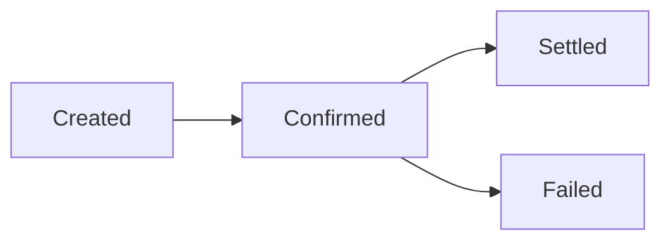

{/* TODO(v2): verify — the V1 page said "payout" and "the balance is deducted from your account", which is cash-out wording, although the page sits in the Pix (receivables) group. This V2 page follows the in-document statuses from the V2 spec and the "balance is deducted" clause was removed. V2 out documents have their own enums: status created, confirmed, settled, onhold, refunded, reversed, failed; stage status created, confirmed, settled, failed, refund_link, onhold. */}

Every document processed by Trio goes through a sequence of stages that represent the transaction lifecycle in our system.

In V2, an in document returned by [`GET /v2/documents/in/{id}`](/v2/api-reference/banking-api/documents/receivables/get-receivable) carries its current `status` and a `stages` array. Each stage records the status the document reached, when it was recorded (`inserted_at`) and, when the stage represents an error, its `error_code` and `error_message`:

```json
"status": "settled",
"stages": [
  {
    "id": "01a11802-3da7-2381-58a7-54b90a2ffa9a",
    "status": "created",
    "inserted_at": "2026-10-07T20:17:02.479108Z",
    "error_code": null,
    "error_message": null
  },
  {
    "id": "01a11802-3da7-af9b-756c-9522bbd3b87f",
    "status": "settled",
    "inserted_at": "2026-10-07T20:17:03.475249Z",
    "error_code": null,
    "error_message": null
  }
]
```

### Transaction Statuses

{/* TODO(v2): verify — `kyc`, `refunded` and `reversed` are defined by the V2 spec (V2_in_document_status) but not described there; V1 had only Created, Confirmed, Settled and Failed */}

* **Created** — The transaction was received and queued for processing.
* **Confirmed** — The settlement process has started.
* **Kyc** — Defined by the V2 API; not yet described.
* **Settled** — The transaction was successfully processed and settled. This is a final status.
* **Refunded** — Defined by the V2 API; not yet described.
* **Reversed** — Defined by the V2 API; not yet described.
* **Failed** — The transaction could not be processed due to invalid information or because it was rejected by the bank. This is a final status.

### Stage Statuses

The `status` of each entry in `stages` is one of `created`, `confirmed`, `kyc`, `settled`, `failed` or `refund_link`. `refund_link` appears only as a stage and never as the document `status`.

### Transaction Flow

The following diagram illustrates the transaction flow:

{/* TODO(v2): verify — the diagram shows the V1 flow; where `kyc`, `refunded` and `reversed` fit is not described in the V2 spec */}



{/* TODO(v2): verify — V2 defines `refunded` and `reversed` after settlement, so whether `Settled` is still final needs confirmation */}

**Final statuses:** `Settled` and `Failed`.

Once a document reaches a final status, its lifecycle is complete.
