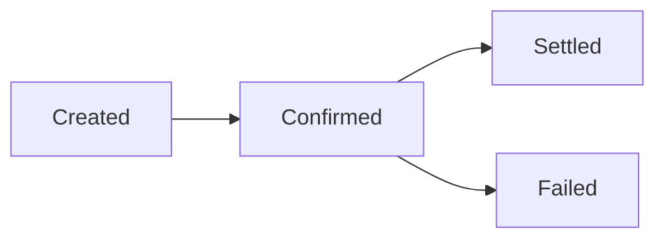

{/* TODO(v2): verify — the V1 page said "payout" and "the balance is deducted from your account", which is cash-out wording, although the page sits in the Pix (receivables) group. This V2 page follows the in-document statuses from the V2 spec and the "balance is deducted" clause was removed. V2 out documents have their own enums: status created, confirmed, settled, onhold, refunded, reversed, failed; stage status created, confirmed, settled, failed, refund_link, onhold. */}

Every deposit that Trio processes becomes an in document, and each in document goes through a sequence of stages that records its lifecycle. This guide lists the statuses an in document can have, the stages it passes through and which statuses are final. For how a deposit is created in the first place, see the [Receivables overview](/v2/guides/receivables/overview).

## Status and stages

An in document returned by [`GET /v2/documents/in/{id}`](/v2/api-reference/banking-api/documents/receivables/get-receivable) carries its current `status` and a `stages` array. Each stage records the status the document reached, when it was recorded (`inserted_at`) and, when the stage represents an error, its `error_code` and `error_message`:

```json
"status": "settled",
"stages": [
  {
    "id": "01a11802-3da7-2381-58a7-54b90a2ffa9a",
    "status": "created",
    "inserted_at": "2026-10-07T20:17:02.479108Z",
    "error_code": null,
    "error_message": null
  },
  {
    "id": "01a11802-3da7-af9b-756c-9522bbd3b87f",
    "status": "settled",
    "inserted_at": "2026-10-07T20:17:03.475249Z",
    "error_code": null,
    "error_message": null
  }
]
```

List in documents with [`GET /v2/documents/in`](/v2/api-reference/banking-api/documents/receivables/list-receivables) or search them with [`POST /v2/documents/in/search`](/v2/api-reference/banking-api/documents/receivables/search-receivables). Each status change also reaches you as a [webhook event](/v2/webhooks/events/overview).

## Document statuses

{/* TODO(v2): verify — `kyc`, `refunded` and `reversed` are defined by the V2 spec (V2_in_document_status) but not described there; V1 had only Created, Confirmed, Settled and Failed */}

| Status | Meaning | Final |
| --- | --- | --- |
| `created` | The transaction was received and queued for processing. | No |
| `confirmed` | The settlement process has started. | No |
| `kyc` | Defined by the V2 API; not yet described. | |
| `settled` | The transaction was successfully processed and settled. | Yes |
| `refunded` | Defined by the V2 API; not yet described. | |
| `reversed` | Defined by the V2 API; not yet described. | |
| `failed` | The transaction could not be processed due to invalid information or because the bank rejected it. | Yes |

## Stage statuses

The `status` of each entry in `stages` is one of the values below. `refund_link` appears only as a stage and never as the document `status`.

| Stage status | Also a document status |
| --- | --- |
| `created` | Yes |
| `confirmed` | Yes |
| `kyc` | Yes |
| `settled` | Yes |
| `failed` | Yes |
| `refund_link` | No |

## Transaction flow

{/* TODO(v2): verify — the diagram shows the V1 flow; where `kyc`, `refunded` and `reversed` fit is not described in the V2 spec */}



{/* TODO(v2): verify — V2 defines `refunded` and `reversed` after settlement, so whether `Settled` is still final needs confirmation */}

The final statuses are `settled` and `failed`. Once a document reaches a final status, its lifecycle is complete.

## Next steps

- [Cash in](/v2/guides/receivables/cash-in): create the dynamic QR code that produces an in document.
- [QR code types](/v2/guides/pix/qr-codes): the status of the QR code itself, before it is paid.
- [Simulate deposit failures](/v2/guides/receivables/simulating-deposit-failures): reproduce rejected and refunded deposits in the sandbox.
- [Cash out](/v2/guides/payments/cash-out): out documents have their own statuses.
